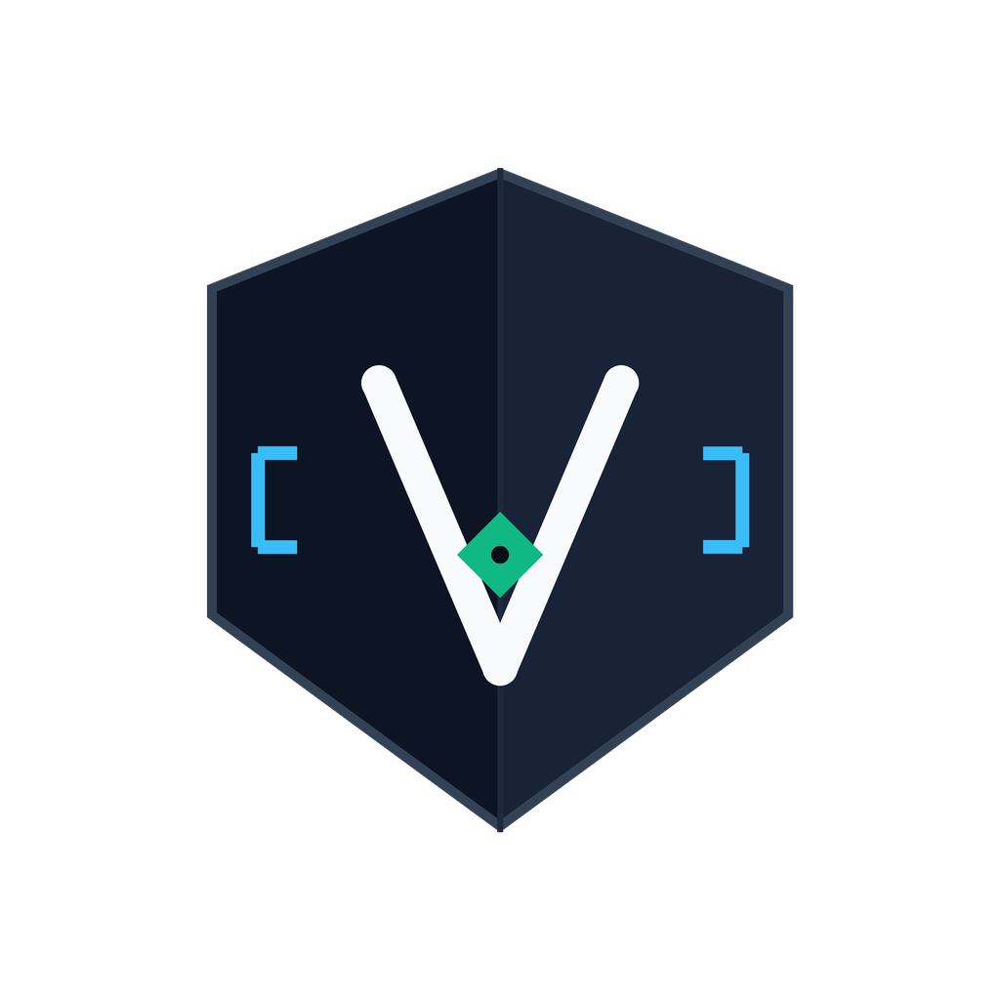

<p align="center">
  
</p>

<h1 align="center">VulnCraft — Manual Bug Hunting Triage Engine</h1>

<p align="center">
  <b>Zero-Dependency Manual Bug Hunting Triage, ScopeGuard, Raw HTTP Sanitizer & PoC Report Engine</b>
</p>

<p align="center">
  
  
  
  
  
</p>

---

```text
==================================================================================================
 VULNCRAFT TRIAGE ENGINE v1.1.0 | Program: AcmeFinTech Bug Bounty Program
 Summary: TOTAL=4 | CRITICAL=1 | HIGH=1 | WARNING=1 | LOW=1 | INFO=0
==================================================================================================
ID         SEVERITY   CVSS   TYPE             SCOPE        ENDPOINT
--------------------------------------------------------------------------------------------------
VULN-001   CRITICAL   9.1    SQLI             IN-SCOPE     https://api.acmefintech.local/v1/tr...
VULN-002   HIGH       8.1    IDOR             IN-SCOPE     https://app.acmefintech.local/api/v...
VULN-003   WARNING    5.4    XSS              IN-SCOPE     https://app.acmefintech.local/dispu...
VULN-004   LOW        3.7    INFO_DISCLOSURE  OUT-SCOPE!   https://blog.acmefintech.local/wp-json
==================================================================================================
```

**VulnCraft** is a lightweight, zero-dependency CLI toolkit engineered for **manual bug hunters, penetration testers, and security researchers**. Instead of acting as another noisy automated scanner, VulnCraft solves the post-discovery workflow bottleneck: validating target scope, calculating deterministic **CVSS v3.1** scores, labeling findings (`CRITICAL`, `HIGH`, `WARNING`, `LOW`, `INFO`), automatically redacting sensitive tokens from raw Burp Suite / Caido HTTP requests, attaching secure-coding remediation blueprints, and exporting **HackerOne/Bugcrowd-ready Markdown reports** alongside a **Standalone Dark-Mode HTML Executive Dashboard**.

---

## Why VulnCraft?

Manual security researchers spend up to 40% of their time formatting Proof-of-Concept (PoC) reports, manually masking session cookies/JWTs, double-checking program scope rules, and explaining code fixes to developers.

VulnCraft automates the entire triage and reporting pipeline in milliseconds using **100% pure Python Standard Library**:

1. **Deterministic Severity Labeling & CVSS v3.1 Engine**: Implements the official FIRST.org CVSS v3.1 mathematical specification to compute scores and classify findings into `CRITICAL`, `HIGH`, `WARNING` (Medium), `LOW`, and `INFO`.
2. **ScopeGuard Target Validator (Path-Traversal Hardened)**: Verifies target endpoints against wildcard `in_scope` and `out_of_scope` rules (`*.domain.com`), normalizes URL paths to block `../` scope bypasses, and ensures out-of-scope rules strictly override in-scope wildcards.
3. **Auto-Redacting HTTP PoC Sanitizer**: Parses raw HTTP requests/responses from Burp Suite or Caido and automatically masks `Authorization: Bearer` tokens, raw JWTs, `Cookie` / `Set-Cookie` secret values (while preserving security flags like `HttpOnly`, `Secure`, `SameSite`), `X-Api-Key` headers, URL secret query parameters, and JSON/form-urlencoded password fields with `[REDACTED]`.
4. **DevFixer Remediation Blueprints**: Automatically maps vulnerability types (`IDOR`, `SQLI`, `XSS`, `RACE_CONDITION`, `MASS_ASSIGNMENT`, `SSRF`) to their official **CWE ID** and attaches syntax-highlighted *Before vs. After* secure code patches.
5. **Dual-Format Instant Export**:
   - **Markdown (`.md`)**: Clean, structured PoC report ready to paste into HackerOne, Bugcrowd, Cyber Army ID, or GitHub Security Advisories.
   - **Interactive Dark-Mode HTML Dashboard (`.html`)**: Single-file, CSP-hardened visual report with interactive severity filtering for clients and engineering teams.

---

## Project Architecture

```text
vulncraft/
├── .github/workflows/ci.yml              # Automated GitHub Actions test pipeline
├── assets/
│   └── vulncraft-shield-transparent.png  # Official VulnCraft shield emblem
├── vulncraft/
│   ├── __init__.py                       # Package metadata (v1.1.0)
│   ├── __main__.py                       # CLI execution entry point
│   ├── cli.py                            # Argument parser & ASCII terminal summary table
│   ├── models.py                         # Dataclasses for Finding & ScopeConfig
│   ├── cvss.py                           # Official FIRST.org CVSS v3.1 base score calculator
│   ├── scope.py                          # Wildcard domain & endpoint ScopeGuard validator
│   ├── sanitizer.py                      # Raw HTTP request/response parser & secret redactor
│   ├── remediation.py                    # CWE mapping & Before/After secure coding patches
│   └── exporter.py                       # Markdown PoC & CSP-hardened Dark-Mode HTML builder
├── examples/
│   ├── sample_scope.json                 # Example Bug Bounty scope definition
│   ├── sample_findings.json              # Example manual bug hunting findings dataset
│   └── raw_request.http                  # Example raw HTTP capture from Burp Suite
├── tests/
│   └── test_vulncraft.py                 # Unit test suite covering CVSS, Scope, Sanitizer, CLI
├── pyproject.toml                        # Standard Python package configuration
├── LICENSE                               # MIT License
└── README.md                             # Documentation
```

---

## Quickstart & Installation

Because **VulnCraft** uses zero external third-party packages, it runs out of the box on Linux, macOS, and Windows with Python 3.10+.

```bash
# 1. Clone the repository
git clone https://github.com/k4slr/vulncraft.git
cd vulncraft

# 2. (Optional) Install globally as a CLI command
pip install -e .
```

---

## Usage Guide

### 1. Triage Findings & Generate Reports (`triage`)

Read a JSON log of manual findings, compute CVSS v3.1 scores, verify scope, redact raw HTTP requests, and export both Markdown and Interactive Dark-Mode HTML reports:

```bash
python3 -m vulncraft triage \
  -f examples/sample_findings.json \
  -s examples/sample_scope.json \
  --md output/poc_report.md \
  --html output/dashboard.html \
  --json-out output/enriched_findings.json
```

### 2. Verify Target Scope Before Testing (`scope-check`)

Check whether a subdomain or endpoint is permitted under a program's rules before sending payloads:

```bash
python3 -m vulncraft scope-check -s examples/sample_scope.json -u https://app.acmefintech.local/api/v2/user
# Output: Target: https://app.acmefintech.local/api/v2/user -> ALLOWED: Matches In-Scope rule '*.acmefintech.local'

python3 -m vulncraft scope-check -s examples/sample_scope.json -u https://blog.acmefintech.local/admin
# Output: Target: https://blog.acmefintech.local/admin -> BLOCKED: Matches Out-of-Scope rule 'blog.acmefintech.local'
```

### 3. Sanitize Raw Burp Suite / Caido Requests (`sanitize`)

Automatically strip live JWTs, session cookies, API keys, and passwords from a raw HTTP file before pasting it into a report or writeup:

```bash
python3 -m vulncraft sanitize -r examples/raw_request.http
```

**Sanitized Output:**

```http
// Detected Endpoint: https://api.acmefintech.local/api/v1/user/profile/update?token=[REDACTED] (POST)
POST /api/v1/user/profile/update?token=[REDACTED] HTTP/1.1
Host: api.acmefintech.local
User-Agent: Mozilla/5.0 (X11; Linux x86_64)
Authorization: Bearer [REDACTED_TOKEN]
Cookie: session_id=[REDACTED]; csrf_token=[REDACTED]; Secure; HttpOnly
X-Api-Key: [REDACTED]
Content-Type: application/json

{"username": "k4slr", "role": "admin", "password": "[REDACTED]"}
```

### 4. Standalone CVSS v3.1 Calculator (`cvss`)

Quickly compute the CVSS v3.1 score and severity label from any vector string directly in your terminal:

```bash
python3 -m vulncraft cvss -v "CVSS:3.1/AV:N/AC:L/PR:L/UI:N/S:U/C:H/I:H/A:N"
# Vector : CVSS:3.1/AV:N/AC:L/PR:L/UI:N/S:U/C:H/I:H/A:N
# Score  : 8.1 / 10.0
# Label  : HIGH
```

---

## Running Unit Tests

Execute the built-in test suite to verify CVSS v3.1 calculations, ScopeGuard wildcard/traversal matching, and HTTP secret redaction:

```bash
python3 -m unittest discover -s tests -v
```

---

## License

Distributed under the **MIT License**. Copyright (c) 2026 **k4slr**. See [`LICENSE`](LICENSE) for full details.
